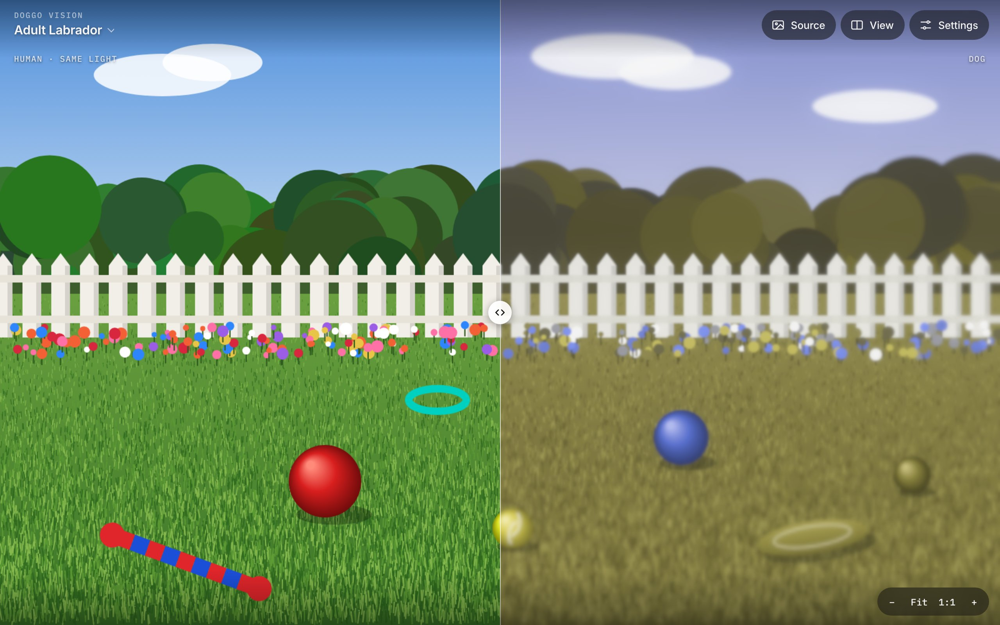

# Dogsight

A browser simulator of how a dog sees: dichromat colour, low acuity that depends on skull shape, night vision, ageing, and 24 eye conditions. It runs as WebGL2 shaders over a photo, a video or your phone's live camera.

**Try it:** https://raulk.github.io/dogsight/ (on a phone, open **Source → Live camera**).


> **This is an estimate, not a diagnosis.** No dog can tell us what it sees. The simulator models the optics and retina of the eye from published measurements, and fills the gaps with human data and engineering estimates, which are labelled as such. It cannot tell you what your dog sees, and it is not veterinary advice. If you are worried about your dog's eyes, see a vet. A red, cloudy, painful eye with a dilated pupil needs urgent care.

## What it shows

| | |
|---|---|
|  |  |
| Night street through the "Senior, 15: both eyes" preset. Lamps scatter into a veil, because the cloudy cornea and the old lens spread light. | The same garden through an adult Labrador's eyes. Reds and greens collapse onto one yellow–brown axis, and detail softens to about a fifth of typical human sharpness. |

- **Colour:** dogs have two cone types, not three. The colour matrix comes from dog cone sensitivities, not from a human colour-blindness filter.
- **Acuity:** about 6–12 cycles per degree for a typical adult dog, against 30–60 for a human. The sharpest region is a round spot in short-nosed dogs and a horizontal streak in long-nosed ones.
- **Light:** rods take over in dim light, so the view gets brighter than a human's but blurrier and noisier.
- **Age and disease:** 24 conditions along the light path, from dry eye and corneal haze to cataract, glaucoma and retinal atrophy. Each has a 0–1 severity.
- **Both eyes:** each eye can have its own conditions, blended where their fields overlap.

The default preset, **Senior, 15: both eyes**, models one real 15-year-old dog with dry eye, a cloudy left cornea and an ageing lens. Its blur and glare are calibrated to measured targets, and it is checked by automated tests (see [Realism tests](#realism-tests)).

## How accurate is it?

The senior presets were checked by rendering test gratings and a point light through the shader, and measuring the result.

| Preset | Measured acuity | Target range | Scattered light (η) | Target |
|---|---|---|---|---|
| Adult Labrador (control) | 6.4 cpd | 5.5–9.0 | 0.07 | 0.03–0.12 |
| Senior, 15: clearer right eye | 5.1 cpd | 4.5–6.0 | 0.24 | 0.18–0.30 |
| Senior, 15: cloudy left eye | 4.0 cpd | 3.0–4.5 | 0.43 | 0.35–0.50 |
| Senior, 15: both eyes | 4.9 cpd | 4.0–6.0 | | |

These numbers say that the simulator hits its targets. They do not say the targets are right. The adult range comes from dog studies. The senior targets also use **human** data on corneal haze, straylight and dry eye, because no dog measurements exist. The tests run on a software GPU, and the presets have not yet been checked on a real phone. An earlier version of these presets was about 4× too blurry; the [realism audit](docs/research/realism-audit.md) found and fixed it.

Read more:

- [Decisions log](docs/decisions.md): each choice and the science behind it, with citations.
- [What we don't know](docs/unknowns.md): human-derived numbers, missing vet measurements, how the two eyes are blended, and the limits of testing.
- [Research](docs/README.md): the full dog vision catalog, the realism audit and the tech stack notes.

## Run it locally

There is no build step to serve it. It is one static HTML file.

```sh
git clone https://github.com/raulk/dogsight
cd dogsight
python3 -m http.server -d site 8000   # then open http://localhost:8000
```

The live camera needs a secure origin: `localhost` works on the same machine, and a phone needs HTTPS (for example the deployed site, or a tunnel).

To change the simulator, edit `src/` and rebuild:

```sh
./build.sh   # writes site/index.html (the site) and dist/artifact.html (a preview build without the camera)
```

Commit `src/` and both outputs.

### Layout

- `src/head.html` (styles), `src/body.html` (markup), `src/shaders.js` (GLSL), `src/model.js` (dog profile → shader parameters), `src/samples.js` (procedural test scenes), `src/app.js` (renderer and UI).
- `tests/`: the realism regression tests.
- `docs/`: decisions, unknowns and research.
- `.github/workflows/pages.yml`: publishes `site/` to GitHub Pages.

### How it works

One composite shader follows the path of light through the eye, in this order: lids, tear film and cornea, chamber and iris, lens, optics, dichromat colour, retinal acuity map, field loss, gain, glare and noise, then temporal effects. Spatially varying blur samples a Gaussian mip pyramid, and every size is in degrees of visual angle. Each stage can be switched off under **Settings → Pipeline**. The **Settings → Data** tab imports eye-photo detector output and exports the profile, condition hypotheses and shader parameters as JSON.

## Realism tests

```sh
npm install playwright        # Chromium must be available to Playwright
pip install numpy pillow
node tests/probe.js tests/out && python3 tests/realism.py tests/out
```

`probe.js` renders 50%-contrast sine gratings (1–16 cpd) and a 0.5° point light through each senior preset in headless Chromium. `realism.py` measures each eye's acuity cutoff, the 1/θ² falloff of the glare veil, and the scattered-light fraction, and fails if any is outside its target range.

## Deploying

GitHub Pages serves `site/` as it is. The workflow in `.github/workflows/pages.yml` publishes it on every push to `main`, so after editing `src/`, run `./build.sh` and commit the output. To set it up on a fork, open **Settings → Pages** and set **Source** to **GitHub Actions**.

## Licence

Code is under the [MIT licence](LICENSE). The documents in `docs/` are under [CC BY 4.0](https://creativecommons.org/licenses/by/4.0/). This is a non-commercial hobby project.

Built with [Claude Code](https://claude.com/claude-code).
