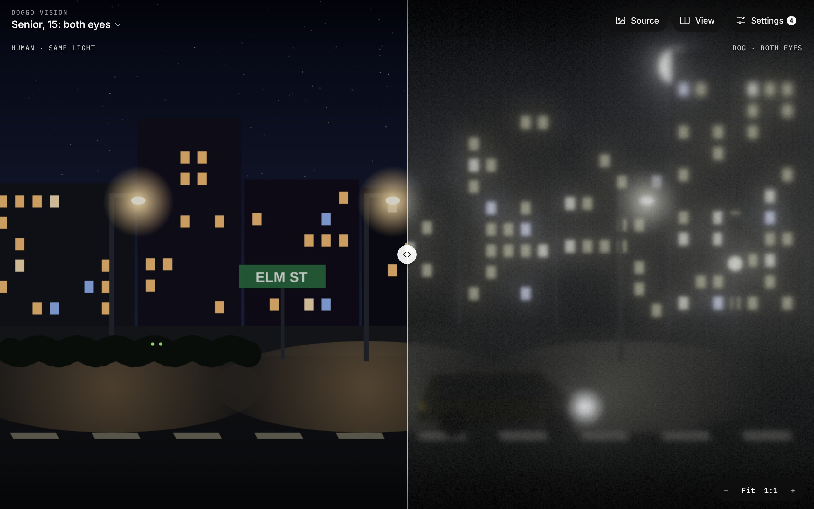

# Dogsight

A browser simulator of how a dog sees: dichromat colour, low acuity that depends on skull shape, night vision, ageing, and 25 eye conditions. It runs as WebGL2 shaders over a photo, a video or your phone's live camera.

**Try it:** https://raulk.github.io/dogsight/ (on a phone, open **Source → Live camera**).


> **This is an estimate, not a diagnosis.** No dog can tell us what it sees. The simulator models the optics and retina of the eye from published measurements, and fills the gaps with human data and engineering estimates, which are labelled as such. It cannot tell you what your dog sees, and it is not veterinary advice. If you are worried about your dog's eyes, see a vet. A red, cloudy, painful eye with a dilated pupil needs urgent care.

## What it shows

| | |
|---|---|
|  |  |
| Night street through the "Senior, 15: both eyes" preset. Lamps scatter into a veil, because the cloudy cornea and the old lens spread light. | The same garden through an adult Labrador's eyes. Reds and greens collapse onto one yellow–brown axis, and detail softens to about a fifth of typical human sharpness. |

- **Colour:** dogs have two cone types, not three. The colour matrix comes from dog cone sensitivities, not from a human colour-blindness filter.
- **Acuity:** about 6–12 cycles per degree for a typical adult dog, against 30–60 for a human. The sharpest region is a round spot in short-nosed dogs and a horizontal streak in long-nosed ones.
- **Light:** rods take over in dim light, so the view gets brighter than a human's but blurrier and noisier.
- **Age and disease:** 25 conditions along the light path, from dry eye and corneal haze to cataract, glaucoma and retinal atrophy. Each has a 0–1 severity.
- **Both eyes.** Each eye stores its own conditions, iris colour and refraction. Measured total refraction bypasses the nuclear-sclerosis offset. In the overlap, the optically clearer eye leads the blend.

Uploaded photos can supply camera and lens details, field of view, scene luminance and subject distance through EXIF, XMP and ICC metadata. Flash exposures are shown in the Scene tab and leave the light-level setting as it was. Supported JPEG gain maps (ISO 21496-1, Ultra HDR and Apple) reconstruct linear HDR radiance for the direct view, glare and bloom. Where Display P3 canvas support is available, P3 photos keep their wider gamut in the floating-point rendering pipeline. Image decoding, including HEIC, depends on the browser.

**Panoramas.** Open **Source → 360° park** and drag to look around. Auto projection recognizes full and cropped GPano images and infers cylindrical projection for wide photos. Change **Scene → Projection** to override it. The panorama spans the dog's anatomical field, about 200° for Pug and 270° for Greyhound. **View → Field zones** marks the binocular overlap. Double-click or use **Center view** to reset the heading.

**Depth and focus.** Turn on **Scene → Per-pixel depth defocus**, then Shift-click or tap an object to focus at its distance. **View → Depth map** shows the inverse-depth texture. The samples have offline procedural depth, including the flat 3 m vision chart. For uploaded photos, Dogsight estimates relative depth on the device with [Depth Anything V2 Small (Apache 2.0)](https://huggingface.co/onnx-community/depth-anything-v2-small). The first estimate downloads ONNX Runtime Web and the quantized model on demand. The browser caches the model where it supports Cache Storage. Use the near and far controls to calibrate relative depth to approximate distances.

**Time and light.** The sustained channel integrates the image over time. A separate 25 ms channel accents moving edges in video and cancels the motion accent for uniform flashes. **Scene → Dark adaptation** lets you watch retinal sensitivity recover at 60× speed or in real time. **Snap adapted** jumps to the steady state.

The default preset, **Senior, 15: both eyes**, is based on a 15-year-old dog with dry eye, a cloudy left cornea and an ageing lens. The browser probes check the preset’s simulated blur and glare against renderer regression targets.

## How accurate is it?

These are renderer regression results on synthetic 50%-contrast gratings and a 0.5° light disc. Acuity here is the frequency at which the renderer transmits 10% of the grating modulation. The adult range draws on dog studies. The senior ranges combine human optical data and modelling estimates. No clinical acuity or straylight measurements were taken for this calibration.

| Preset | Fresh at 1.2 s | Dry at 5.8 s | Fresh target | Model straylight fraction (η) | η target |
|---|---:|---:|---:|---:|---:|
| Adult Labrador (control) | 5.70 cpd | 5.70 cpd | 5.5–9.0 | 0.07 | 0.03–0.12 |
| Senior, 15: clearer right eye | 4.51 cpd | 4.51 cpd | 4.5–6.0 | 0.24 | 0.18–0.30 |
| Senior, 15: cloudy left eye | 3.09 cpd | 2.41 cpd | 3.0–4.5 | 0.46 | 0.35–0.50 |
| Senior, 15: both eyes | 4.27 cpd | 4.12 cpd | 4.0–6.0 | — | — |

The float-buffer glare tail falls approximately as 1/θ² from 1° to 8° for these monocular presets. The isolated Gaussian control crosses 5% MTF at 8.013 cpd and 10% at about 7.024 cpd at both tested fields of view. These results come from headless Chromium using a software GPU.

Read more:

- [Decisions log](docs/decisions.md): each choice and the science behind it, with citations.
- [What we don't know](docs/unknowns.md): human-derived numbers, missing vet measurements, how the two eyes are blended, and the limits of testing.
- [Research](docs/README.md): the full dog vision catalog, the realism audit and the tech stack notes.

## Run it locally

Vite serves the TypeScript app in development and bundles it into one static HTML file. Use Node.js 24.

```sh
git clone https://github.com/raulk/dogsight
cd dogsight
npm ci
npm run dev                           # open the local URL printed by Vite
npm run check                         # strict types, lint, formatting and unit tests
npm run build                         # writes site/index.html
```

The live camera needs a secure origin: `localhost` works on the same machine, and a phone needs HTTPS (for example the deployed site, or a tunnel).

Open `site/index.html` directly or serve it with `python3 -m http.server -d site 8000`. The `./build.sh` wrapper also copies the bundle to `dist/artifact.html` for embedded previews.

### Layout

- `index.html` and `src/styles.css` define the interface. `src/main.ts` wires together the UI, viewport, media and renderer.
- `src/model.ts` compiles each eye's optics from `src/state.ts`. `src/gl.ts` applies `src/shaders.ts` in WebGL2.
- `src/metadata.ts` reads photo metadata and gain maps. `src/samples.ts` supplies the procedural scenes.
- `tests/` contains unit tests and Chromium realism probes.
- `docs/`: decisions, unknowns and research.
- `.github/workflows/pages.yml`: publishes `site/` to GitHub Pages.

### How it works

The WebGL2 pipeline uses rectilinear camera projection for photos and video, with local pixel scales derived from visual angle. It combines angular optical blur with a Gaussian mip pyramid and applies pupil-plane attenuation to the direct image, glare, bloom and halos. Retinal contrast sensitivity uses five Laplacian bands, and low-light rod noise uses angular pooling cells that grow toward the periphery. Use **Settings → Pipeline** to isolate stages. The **Settings → Data** tab imports eye-photo detector output and exports the profile, condition hypotheses and shader parameters as JSON.

## Realism tests

```sh
npm install --no-save playwright    # Chromium must be available to Playwright
pip install numpy pillow
npm run build && node tests/probe.js tests/out && python3 tests/realism.py tests/out
```

`probe.js` renders equiangular sine gratings and a 0.5° light disc in headless Chromium. `realism.py` checks fresh and dry-phase acuity, glare falloff, encircled energy, analytic Gaussian MTF at 20° and 40° FOV, and zero luminance on black and behind complete SARDS. The float probes also check HDR reconstruction, anterior attenuation, Display P3 conversion and binocular projection, plus per-pixel focus reversal, panoramic field coverage and eye asymmetry, motion accent localization, and dark adaptation. Linear float readback requires `EXT_color_buffer_float`.

## Deploying

The workflow in `.github/workflows/pages.yml` runs `npm ci`, `npm run check` and `npm run build`, then publishes `site/` to GitHub Pages on every push to `main`. To set it up on a fork, open **Settings → Pages** and set **Source** to **GitHub Actions**.

## Licence

Code is under the [MIT licence](LICENSE). The documents in `docs/` are under [CC BY 4.0](https://creativecommons.org/licenses/by/4.0/). This is a non-commercial hobby project.

Built with [Claude Code](https://claude.com/claude-code).
