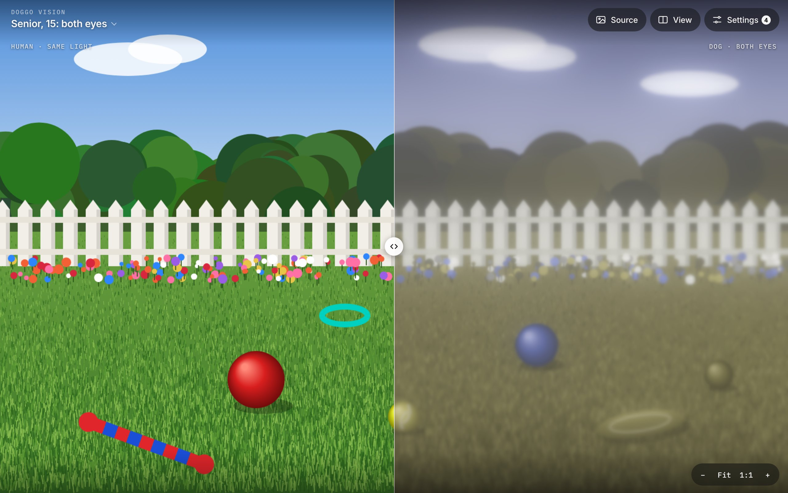

# Dogsight

A browser simulator of how a dog sees: dichromat colour, low acuity that depends on skull shape, night vision, ageing, and 25 eye conditions. It runs as WebGL2 shaders over a photo, a video or your phone's live camera.

**Try it:** https://raulk.github.io/dogsight/ (on a phone, open **Source → Live camera**).

**Runs 100% locally — nothing is uploaded.** Photos, videos, live camera frames, EXIF metadata and imported JSON are processed entirely in your browser and never leave your device. If you opt into AI depth estimation on a photo without embedded depth, your browser downloads the ONNX Runtime and Depth Anything V2 weights on demand and runs inference locally on your device.



> **This is an estimate, not a diagnosis.** No dog can tell us what it sees. The simulator models the optics and retina of the eye from published measurements, and fills the gaps with human data and engineering estimates, which are labelled as such. It cannot tell you what your dog sees, and it is not veterinary advice. If you are worried about your dog's eyes, see a vet. A red, cloudy, painful eye with a dilated pupil needs urgent care.

## What it shows

| | |
|---|---|
|  |  |
| Night street through the "Senior, 15: both eyes" preset. Lamps scatter into a veil, because the cloudy cornea and the old lens spread light. | The same garden through an adult Labrador's eyes. Reds and greens collapse onto one yellow–brown axis, and detail softens to about a fifth of typical human sharpness. |

## Features

- **True dog colour:** Dogs have two colour receptors instead of three, so reds and greens blend into shades of yellow and brown while blues still stand out.
- **Sharpness by breed and nose shape:** A healthy dog sees roughly 4–5× softer detail than a human. Long-nosed breeds (like Greyhounds) have a wide horizontal band of sharpest focus for scanning the horizon, while short-nosed breeds (like Pugs) have a rounder central sweet spot.
- **Night vision & dark adaptation:** In dim light, dogs see brighter than humans thanks to rod-heavy retinas and a reflective tapetum, at the cost of softer detail, grain, and slower colour-to-night adaptation—which you can watch in real time or at 60× speed.
- **25 eye conditions & ageing:** Explore how dry eye, corneal haze, cataracts, glaucoma, retinal disease, and normal age-related lens fog change what a dog sees, with independent settings for the left and right eye.
- **Focus & real photo depth:** Dogs can't focus sharply on very close objects (closer than ~40 cm). Open the top-right **Depth** menu and Shift-click or tap anything in a scene to focus there. iPhone and Android Portrait photos use their embedded depth map automatically; any other photo can estimate depth privately on your device.
- **360° wide field of view:** Dogs see much wider around the sides than humans (about 200° for a Pug up to 270° for a Greyhound). Try **Source → 360° park** or open a panorama photo and drag to look around.
- **Photos, videos & live camera:** Point your phone's camera around your home or open your own photos (automatically reading camera lens, lighting, HDR highlights, and wide P3 colour where available).
- **Split comparison & Stats for nerds:** Drag the divider to compare human vs. dog vision side by side, toggle acuity/field/depth overlays, or enable **View → Stats for nerds** to inspect live optical and decode details.

Dogsight opens on **Adult Labrador** as a healthy baseline. The **Senior, 15: both eyes** preset models a 15-year-old dog with dry eye, a cloudy left cornea and an ageing lens; the browser probes check both presets' simulated blur and glare against renderer regression targets.

## How accurate is it?

These are renderer regression results on synthetic 50%-contrast gratings and a 0.5° light disc. Acuity here is the frequency at which the renderer transmits 10% of the grating modulation. The adult range draws on dog studies. The senior ranges combine human optical data and modelling estimates. No clinical acuity or straylight measurements were taken for this calibration.

| Preset | Fresh at 1.2 s | Dry at 5.8 s | Fresh target | Model straylight fraction (η) | η target |
|---|---:|---:|---:|---:|---:|
| Adult Labrador (control) | 5.70 cpd | 5.70 cpd | 5.5–9.0 | 0.07 | 0.03–0.12 |
| Senior, 15: clearer right eye | 4.51 cpd | 4.51 cpd | 4.5–6.0 | 0.24 | 0.18–0.30 |
| Senior, 15: cloudy left eye | 3.09 cpd | 2.41 cpd | 3.0–4.5 | 0.46 | 0.35–0.50 |
| Senior, 15: both eyes | 4.27 cpd | 4.12 cpd | 4.0–6.0 | — | — |

The float-buffer glare tail falls approximately as 1/θ² from 1° to 8° for these monocular presets. The isolated Gaussian control crosses 5% MTF at 8.013 cpd and 10% at about 7.024 cpd at both tested fields of view. These results come from headless Chromium using a software GPU.

Read more:

- [Decisions log](docs/decisions.md): each choice and the science behind it, with citations.
- [What we don't know](docs/unknowns.md): human-derived numbers, missing vet measurements, how the two eyes are blended, and the limits of testing.
- [Research](docs/README.md): the full dog vision catalog, the realism audit and the tech stack notes.

## Run it locally

Vite serves the TypeScript app in development and bundles it into one static HTML file. Use Node.js 24.

```sh
git clone https://github.com/raulk/dogsight
cd dogsight
npm ci
npm run dev                           # open the local URL printed by Vite
npm run check                         # strict types, lint, formatting and unit tests
npm run build                         # writes site/index.html
```

The live camera needs a secure origin: `localhost` works on the same machine, and a phone needs HTTPS (for example the deployed site, or a tunnel).

Open `site/index.html` directly or serve it with `python3 -m http.server -d site 8000`. The `./build.sh` wrapper also copies the bundle to `dist/artifact.html` for embedded previews.

### Layout

- `index.html` and `src/styles.css` define the interface. `src/main.ts` wires together the UI, viewport, media and renderer.
- `src/model.ts` compiles each eye's optics from `src/state.ts`. `src/gl.ts` applies `src/shaders.ts` in WebGL2.
- `src/metadata.ts` and `src/photo-depth.ts` read EXIF/XMP metadata, HDR gain maps and embedded portrait depth maps. `src/depth.ts` runs optional on-device depth estimation. `src/samples.ts` supplies the procedural scenes.
- `tests/` contains unit tests and Chromium realism probes.
- `docs/`: decisions, unknowns and research.
- `.github/workflows/pages.yml`: publishes `site/` to GitHub Pages.

## Shader pipeline

Dogsight simulates canine vision in real time in the browser using a multi-pass WebGL2 optical pipeline (`src/shaders.ts`, orchestrated by `src/gl.ts`) parameterized by a dog's breed, age, skull shape, lighting and eye conditions. When you load a photo, video, 360° panorama or live camera feed, it reads EXIF/HDR gain-map metadata and any embedded portrait depth map (or estimates depth on-device with Depth Anything V2), linearizes the scene radiance, and builds a multi-scale blur pyramid. For each pixel—and independently for each eye in binocular mode—the main shader projects field angles (rectilinear for photos and video, spherical for panoramas) to scale acuity and visual-streak or area-centralis blur, computes per-pixel diopter defocus from the dog's limited (~2–3 D) accommodation and pupil diameter, attenuates and scatters light through anterior media (tear film, corneal opacity, lens haze, veiling glare, bloom and halos), converts colour to canine blue–yellow dichromacy or rod-dominated night vision with five-band Laplacian contrast sensitivity, angular rod noise, tapetal boost and biphasic dark adaptation, applies retinal/neural field defects, and runs separate sustained and transient temporal filters for motion sensitivity and low-light smear.

The rendering runs on the GPU as chained WebGL2 passes rather than a single fragment shader for three reasons:

1. **Wide blur, veiling glare and motion need multiple shader passes.** Sampling a 20°+ glare tail or five spatial-frequency CSF bands in one fragment pass would require thousands of texture taps per pixel, and a single stateless pass has no memory of previous frames. Dogsight therefore chains focused GPU passes over floating-point framebuffers: `FS_PANO` (reprojection) → `FS_LINEARIZE` (HDR/Display P3 radiance) → `FS_DOWN` (Gaussian mip pyramid) → `FS_MAIN` (optics, defocus, colour, retina) → `FS_TEMPORAL` (ping-pong sustained/transient history) → `FS_BLEND` (binocular merge) → `FS_DISPLAY`.
2. **Monocular depth estimation cannot be done by a local pixel shader.** When a photo has no embedded hardware depth map, inferring near versus far requires global scene understanding (objects, occlusion, perspective). That uses a neural network (Depth Anything V2 Small via ONNX Runtime Web, which executes on WebGPU compute shaders where available and falls back to WASM).
3. **Container parsing and biology math run once per photo or setting.** Parsing EXIF, HDR gain maps and MPF/HEIC depth containers—and compiling breed, age and eye-condition parameters into uniform values—runs on the CPU so the GPU passes stay fast at 60 fps.

Use **Settings → Pipeline** to isolate individual optical stages, and **Settings → Data** to import eye-photo detector output or export the profile, condition hypotheses and shader parameters as JSON.

## Realism tests

```sh
npm install --no-save playwright    # Chromium must be available to Playwright
pip install numpy pillow
npm run build && node tests/probe.js tests/out && python3 tests/realism.py tests/out
```

`probe.js` renders equiangular sine gratings and a 0.5° light disc in headless Chromium. `realism.py` checks fresh and dry-phase acuity, glare falloff, encircled energy, analytic Gaussian MTF at 20° and 40° FOV, and zero luminance on black and behind complete SARDS. The float probes also check HDR reconstruction, anterior attenuation, Display P3 conversion and binocular projection, plus per-pixel focus reversal, panoramic field coverage and eye asymmetry, motion accent localization, and dark adaptation. Linear float readback requires `EXT_color_buffer_float`.

## Deploying

The workflow in `.github/workflows/pages.yml` runs `npm ci`, `npm run check` and `npm run build`, then publishes `site/` to GitHub Pages on every push to `main`. To set it up on a fork, open **Settings → Pages** and set **Source** to **GitHub Actions**.

## Licence

Code is under the [MIT licence](LICENSE). The documents in `docs/` are under [CC BY 4.0](https://creativecommons.org/licenses/by/4.0/). This is a non-commercial hobby project.

Built with [Claude Code](https://claude.com/claude-code).
